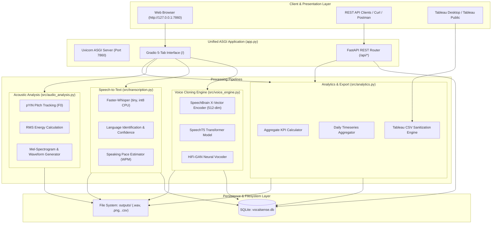

# VocalSense AI: Personalised Voice Cloning, Speech Processing & Analytics

[](https://www.python.org/)
[](https://react.dev/)
[](https://tailwindcss.com/)
[](https://pytorch.org/)
[](https://fastapi.tiangolo.com/)
[-orange.svg)](http://127.0.0.1:7860/gradio)
[](https://speechbrain.github.io/)
[](https://github.com/SYSTRAN/faster-whisper)
[](https://www.sqlite.org/)
[](TABLEAU_GUIDE.md)
[](tests/)

An end-to-end, portfolio-worthy AI speech workspace combining **zero-shot reference-conditioned voice cloning**, **offline automatic speech recognition (ASR)**, **acoustic signal analysis**, **relational SQLite persistence**, a **custom React 18 + TypeScript + Tailwind CSS dark workspace**, a **FastAPI REST API**, and a **100% functional Gradio classic fallback interface**.

---

## 1. Project Overview & System Capabilities

VocalSense AI demonstrates how modern deep learning foundation models, signal processing algorithms, and data engineering pipelines can be synthesized into a practical, locally deployable desktop and enterprise application.

### Core Capabilities:
1. **Personalised Zero-Shot Voice Cloning**: Clones speaker vocal timbre from 3–10 seconds of reference speech using a 512-dimensional TDNN x-vector encoder, Microsoft SpeechT5 autoregressive transformer, and a HiFi-GAN vocoder.
2. **Offline Speech Transcription (STT)**: High-performance speech-to-text powered by `faster-whisper` (`tiny` model with int8 quantization on CPU), featuring automatic language detection, timestamping, word counting, and speaking pace (WPM) calculation.
3. **Acoustic Signal Processing**: Pitch ($F_0$) extraction via probabilistic YIN (`pYIN`), RMS energy computation, spectral centroid analysis, and dual-domain Mel-spectrogram visualization.
4. **Data Persistence & Audit Logging**: Embedded SQLite database (`vocalsense.db`) with Write-Ahead Logging (WAL), automatic schema migrations, parameterized queries, and millisecond-level telemetry.
5. **Unified Full-Stack Architecture**: Gradio 6.x interactive 5-tab user interface mounted onto a production-ready FastAPI ASGI application served concurrently via Uvicorn on port `7860`.
6. **Data Analytics & Tableau Integration**: Sanitized, formula-injection-safe CSV export pipeline for Tableau Desktop and Tableau Public, enabling interactive dashboards for speech metrics, operational throughput, and model latency.

---

## 2. System Architecture



---

## 3. Technology Stack & Model Provenance

In accordance with academic and engineering transparency standards, the table below documents all components, versions, and origins:

| Layer / Component | Technology / Model | Role & Source |
| :--- | :--- | :--- |
| **Speaker Encoder** | `speechbrain/spkrec-xvect-voxceleb` (1.1.1) | 512-dim x-vector speaker representation extraction. Pretrained on VoxCeleb. |
| **Acoustic Model** | `microsoft/speecht5_tts` (Transformers 4.57.3) | Autoregressive transformer generating mel-spectrograms from text conditioned on speaker embedding. |
| **Neural Vocoder** | `microsoft/speecht5_hifigan` | Generative adversarial vocoder reconstructing 16 kHz time-domain waveforms. |
| **Speech Transcription** | `faster-whisper` (1.2.1, tiny, int8) | Highly optimized CTranslate2 Whisper implementation for offline CPU speech-to-text. |
| **Signal Processing** | `librosa` 1.0.0, `soundfile` 0.14.0, `scipy` 1.17.0 | Audio validation, resampling, pYIN fundamental frequency extraction, and RMS energy. |
| **Relational Database** | Python `sqlite3` (WAL mode enabled) | Transactional persistence of operations, durations, words, pace, and acoustic metrics (`vocalsense.db`). |
| **REST API Server** | `FastAPI` 0.133.0 & `Uvicorn` 0.43.0 | Asynchronous REST API routing mounted at `/api/*` with OpenAPI docs at `/docs`. |
| **Interactive UI** | `Gradio` 6.30.0 | Tabbed interactive interface mounted onto FastAPI root (`/`). |
| **Data Analytics** | `src/analytics.py` & Tableau Desktop | Summary KPI computation, trend aggregation, formula-injection sanitization, and CSV export. |
| **Automated Testing** | `pytest` 9.0.3 | 36 automated unit and integration tests across 9 test suites. |

---

## 4. Database Architecture & Schema

All recording, cloning, and transcription operations are persisted to `vocalsense.db`.

```sql
CREATE TABLE IF NOT EXISTS recordings (
    recording_id TEXT PRIMARY KEY,
    created_at TEXT NOT NULL,                     -- ISO 8601 UTC timestamp
    operation_type TEXT NOT NULL,                 -- 'voice_cloning', 'transcription', 'acoustic_analysis'
    file_name TEXT NOT NULL,                      -- Base filename
    duration_seconds REAL NOT NULL,               -- Audio duration
    sample_rate INTEGER NOT NULL,                 -- Sampling rate (e.g., 16000)
    transcript TEXT,                              -- Generated or recognized text
    word_count INTEGER,                           -- Number of words
    character_count INTEGER,                      -- Number of characters
    language_code TEXT,                           -- ISO language code (e.g., 'en')
    processing_status TEXT NOT NULL,              -- 'success' or 'failed'
    processing_duration_ms REAL NOT NULL,         -- Total execution latency in milliseconds
    stage_durations_json TEXT,                    -- JSON breakdown of pipeline stages
    estimated_words_per_minute REAL,              -- Speaking pace (WPM)
    mean_pitch_hz REAL,                           -- Fundamental frequency (F0)
    rms_energy REAL,                              -- Root-mean-square amplitude
    spectral_centroid_hz REAL,                    -- Spectral centroid
    speaker_similarity REAL,                      -- Embedding cosine similarity [-1.0, 1.0]
    error_message TEXT                            -- Exception diagnostics if failed
);
```

### Database Key Engineering Highlights:
- **Write-Ahead Logging (WAL):** Prevents read/write locks during concurrent API requests.
- **Auto-Migrations:** Automatically verifies column existence via `PRAGMA table_info` and safely performs schema migrations without data loss.
- **Parameterized SQL:** Eliminates SQL injection vulnerabilities across all search and query paths.

---

## 5. REST API Documentation

The server exposes a fully typed REST API alongside the web UI.

| Endpoint | Method | Description | Sample Query / Body |
| :--- | :--- | :--- | :--- |
| `/api/health` | `GET` | Health check and system capabilities. | *None* |
| `/api/recordings` | `GET` | Paginated recording history with filters. | `?limit=10&offset=0&operation_type=voice_cloning&status=success` |
| `/api/recordings/{id}` | `GET` | Detailed record for a single execution. | `/api/recordings/9dae7f04-3708-4cd5-9e74-df5ebeacb119` |
| `/api/analytics/summary` | `GET` | Aggregate KPIs (totals, averages, RTF, WPM). | *None* |
| `/api/analytics/timeseries`| `GET` | Daily operational volume and latency trends. | *None* |
| `/api/analytics/export` | `GET` | Generates and downloads sanitized Tableau CSV. | *None (Returns `text/csv; charset=utf-8`)* |

| `/api/samples` | `GET` | List bundled authorized reference audio recordings. | *None* |
| `/api/audio/inspect` | `POST` | Inspect acoustic properties (F0, RMS, centroid, plot). | `sample_id` or `audio_file` |
| `/api/voice/clone` | `POST` | Zero-shot reference-conditioned neural voice synthesis. | `sample_id`/`audio_file`, `text`, `language` |
| `/api/transcribe` | `POST` | Offline speech transcription and pace calculation. | `sample_id`/`audio_file`, `language` |

### Example cURL Commands:
```bash
# 1. Health check
curl http://127.0.0.1:7860/api/health

# 2. Inspect reference audio
curl -X POST http://127.0.0.1:7860/api/audio/inspect -d "sample_id=sample_speaker_male"

# 3. Analytics Summary
curl http://127.0.0.1:7860/api/analytics/summary

# 4. Export Tableau-Ready CSV
curl http://127.0.0.1:7860/api/analytics/export -o tableau_export.csv
```

---

## 6. Installation & Execution

### 6.1 Prerequisites
- **Python:** 3.12 or 3.14 (64-bit)
- **Node.js:** v18+ (Node v22 / npm 10 recommended)
- **RAM:** Minimum 8 GB (16 GB recommended for CPU inference)
- **Disk:** ~3.5 GB for pretrained model weights and dependencies

### 6.2 Setup
```powershell
# 1. Navigate to workspace
cd "c:\Users\hp\OneDrive\Documents\3rd sem All LAB\VocalSenseAI"

# 2. Install Python dependencies
pip install -r requirements.txt

# 3. (Optional) Rebuild React frontend
cd frontend
npm install
npm run build
cd ..
```

### 6.3 Run the Application
```powershell
python app.py
```
Output:
```
INFO:     Started server process
INFO:     Waiting for application startup.
INFO:     Application startup complete.
INFO:     Uvicorn running on http://127.0.0.1:7860 (Press CTRL+C to quit)
[VocalSense AI] Starting Unified Server on http://127.0.0.1:7860 ...
  -> React Premium UI:  http://127.0.0.1:7860/
  -> Gradio Fallback:   http://127.0.0.1:7860/gradio
  -> Swagger API Docs:  http://127.0.0.1:7860/docs
```

Access Points:
* **Primary Modern Web Workspace (React 18 + Tailwind):** `http://127.0.0.1:7860/`
* **Gradio Classic Interface (100% Fallback):** `http://127.0.0.1:7860/gradio`
* **Interactive API Documentation (Swagger/OpenAPI):** `http://127.0.0.1:7860/docs`

---

## 7. Automated Test Suite (38 Tests)

The test suite covers unit and integration tests across all modules.

```powershell
python -m pytest tests/ -v
```

### Test Suite Breakdown:
* `tests/test_nlp.py` (7 tests): Abbreviation expansion, currency normalization, empty/short/long text constraints, and language validation.
* `tests/test_audio_analysis.py` (7 tests): Valid audio validation, silent file rejection, missing file handling, unsupported extension rejection, pYIN pitch estimation accuracy, acoustic property analysis, and visual plot generation.
* `tests/test_voice_engine.py` (3 tests): Model loading, speaker embedding extraction, and end-to-end voice cloning synthesis.
* `tests/test_evaluation.py` (4 tests): Cosine similarity calculation, distinct speaker discrimination, comparison structure, and 4-panel acoustic plot.
* `tests/test_database.py` (4 tests): Database schema initialization, CRUD save/get, pagination, and empty query safety.
* `tests/test_transcription.py` (3 tests): Faster-Whisper initialization, audio transcription with WPM calculation, and non-existent audio rejection.
* `tests/test_analytics.py` (3 tests): Metric calculation correctness, CSV formula-injection sanitization, and summary/timeseries aggregation.
* `tests/test_export.py` (2 tests): Tableau CSV header formatting, encoding (`utf-8-sig`), and disk file creation.
* `tests/test_api.py` (5 tests): FastAPI health endpoint, paginated recordings retrieval, analytics endpoints, sample voices endpoint, and audio inspection via TestClient.

**Result: 38 passed, 0 failed in ~32 seconds.**

---

## 8. SECTION A: Data Analytics Using Tableau

VocalSense AI features a production-ready analytics engine designed specifically for business intelligence and telemetry monitoring in **Tableau Desktop** and **Tableau Public**.

### 8.1 Export File & Security Engineering
- **File Location:** `outputs/vocalsense_analytics_export.csv`
- **Encoding:** `UTF-8 with BOM` (`utf-8-sig`) for native double-click opening in Microsoft Excel and Tableau without character corruption.
- **Privacy Assurance:** Raw audio binaries, audio waveforms, and raw transcript text are **excluded** from the analytics export to comply with data privacy policies. Only acoustic and operational aggregates are exported.
- **CSV Formula-Injection Protection:** Any textual field beginning with dangerous spreadsheet control characters (`=`, `+`, `-`, `@`) is prepended with a single quote `'` to prevent remote formula execution.

### 8.2 Data Schema (15 Standard Columns)
| Column Name | Data Type | Role in Tableau | Description |
| :--- | :--- | :--- | :--- |
| `recording_id` | String | Dimension | Unique UUID string identifying the recording session. |
| `created_at` | DateTime (ISO) | Dimension (Temporal)| UTC timestamp (`YYYY-MM-DDTHH:MM:SSZ`) for time-series analysis. |
| `operation_type` | String | Dimension | Category: `voice_cloning`, `transcription`, `acoustic_analysis`. |
| `file_name` | String | Dimension | Name of input or output audio file. |
| `duration_seconds` | Float | Measure | Exact duration of processed speech in seconds. |
| `word_count` | Integer | Measure | Number of spoken or synthesized words. |
| `character_count` | Integer | Measure | Total textual characters processed. |
| `language_code` | String | Dimension | Detected or synthesized language (`en`, `es`, `fr`, etc.). |
| `processing_status`| String | Dimension | `success` or `failed`. |
| `processing_duration_ms`| Float | Measure | Total end-to-end execution latency in milliseconds. |
| `estimated_words_per_minute`| Float | Measure | Speaking pace normalized to 60 seconds of audio. |
| `mean_pitch_hz` | Float | Measure | Fundamental vocal frequency ($F_0$) in Hertz. |
| `rms_energy` | Float | Measure | Root Mean Square energy (loudness measure). |
| `spectral_centroid_hz`| Float | Measure | Acoustic brightness and timbral center of mass. |
| `speaker_similarity` | Float | Measure | Latent x-vector cosine similarity score $[-1.0, 1.0]$. |

### 8.3 Recommended Calculated Fields in Tableau
1. **Processing Latency (Seconds):**
   ```tableau
   [processing_duration_ms] / 1000.0
   ```
2. **Real-Time Factor (RTF):**
   ```tableau
   ([processing_duration_ms] / 1000.0) / [duration_seconds]
   ```
3. **Success Rate (%):**
   ```tableau
   COUNT(IF [processing_status] = 'success' THEN 1 END) / COUNT([recording_id]) * 100.0
   ```
4. **Pace Category:**
   ```tableau
   IF ISNULL([estimated_words_per_minute]) THEN "No Transcript"
   ELSEIF [estimated_words_per_minute] < 120 THEN "Deliberate / Slow (<120 WPM)"
   ELSEIF [estimated_words_per_minute] <= 170 THEN "Conversational (120-170 WPM)"
   ELSE "Rapid (>170 WPM)"
   END
   ```

### 8.4 Designed Tableau Dashboards
For detailed step-by-step visual creation instructions, refer to [`TABLEAU_GUIDE.md`](TABLEAU_GUIDE.md).
1. **Dashboard 1: Speech Processing Activity & Operational Overview**: High-level executive view displaying Total Processed Audio Minutes, Overall Success Rate %, Activity Volume Trends, and Operation Type Breakdown.
2. **Dashboard 2: Speech Characteristics & Acoustic Analytics**: Audio engineering dashboard illustrating Speaking Pace (WPM) histograms, Pitch ($F_0$) distributions, and Speaker Cosine Similarity distributions.
3. **Dashboard 3: Computational Performance & System Latency**: Performance engineering dashboard plotting Processing Latency vs. Audio Duration scatter plots, Real-Time Factor (RTF) benchmarks, and latency percentiles.

---

## 9. SECTION B: Technical Training & Practical Knowledge

### 9.1 Speech Processing & Acoustic Analysis
- **What is Fundamental Frequency ($F_0$)?**
  Fundamental frequency ($F_0$) represents the rate at which human vocal cords vibrate during voiced speech. It correlates perceptually with acoustic pitch. Male voices typically range from $85 - 180\text{ Hz}$, while female voices range from $165 - 255\text{ Hz}$. VocalSense AI employs the **probabilistic YIN (`pYIN`)** algorithm, which uses normalized cross-correlation and Hidden Markov Models (HMM) to distinguish voiced and unvoiced frames.
- **Why Can't Pitch Prove Identity?**
  Pitch varies dynamically within a single speaker based on emotional state, question inflection, sentence emphasis, and physical fatigue. While pitch statistics provide an acoustic description of a recording, speaker identity requires invariant deep representations (such as TDNN x-vectors or d-vectors).
- **RMS Energy vs. Loudness:**
  Root Mean Square (RMS) energy quantifies the physical signal power of an audio waveform. Perceived loudness, however, is psychoacoustic and frequency-dependent (modeled by equal-loudness contours like A-weighting or ITU-R BS.1770).

### 9.2 Zero-Shot Voice Cloning Mechanics
- **X-Vector Speaker Embeddings:**
  SpeechBrain utilizes a Time-Delay Neural Network (TDNN) trained on thousands of speakers in the VoxCeleb dataset. Frame-level representations are pooled across time to generate a fixed-size 512-dimensional vector that captures anatomical and timbral vocal traits regardless of spoken words.
- **SpeechT5 Transformer & HiFi-GAN:**
  SpeechT5 uses an encoder-decoder architecture. The text tokens are encoded, and the decoder generates mel-spectrogram frames autoregressively, conditioned on the 512-dimensional speaker embedding. The **HiFi-GAN vocoder** uses multi-period and multi-scale discriminators to synthesize a continuous 16 kHz time-domain waveform from the generated mel-spectrogram.

### 9.3 Full-Stack Serving & ASGI Architecture
- **Why Mount Gradio onto FastAPI?**
  Gradio provides high-level UI controls for rapid demonstration, while FastAPI provides asynchronous, high-throughput REST API endpoints. By using `gr.mount_gradio_app(server, demo, path="/")`, both services run on the same event loop and network port (`7860`), avoiding CORS complications and dual-process management.
- **SQLite Concurrency with WAL Mode:**
  Standard SQLite locks the entire database file during write operations. Enabling Write-Ahead Logging (`PRAGMA journal_mode=WAL;`) allows simultaneous concurrent readers while a background thread executes write transactions.

---

## 10. Privacy, Ethics & Responsible AI

1. **Explicit Consent & Authorized Use**: VocalSense AI is designed exclusively for assistive technologies, accessibility, and authorized voice reproduction with explicit user consent.
2. **Biometric Security Disclaimer**: Speaker similarity scores represent latent vector distances and cannot serve as legal biometric authentication.
3. **No Cloud Data Leakage**: All inference runs 100% locally on the host CPU. No audio, embeddings, or transcripts are transmitted over the Internet.
4. **Synthetic Speech Watermarking**: Generated audio files are identified in user interfaces and logs as synthetic speech.

---

## 11. Directory Structure

```
VocalSenseAI/
├── app.py                                  # Unified FastAPI + Gradio server
├── requirements.txt                        # Pinned dependencies
├── README.md                               # Comprehensive documentation & training guide
├── TABLEAU_GUIDE.md                        # Step-by-step Tableau connection & dashboard guide
├── conftest.py                             # Pytest configuration
├── vocalsense.db                           # SQLite database (auto-created)
├── src/
│   ├── __init__.py                         # Package marker
│   ├── database.py                         # SQLite persistence, migrations & queries
│   ├── nlp_preprocessor.py                 # Lexical normalization & text validation
│   ├── audio_analysis.py                   # pYIN pitch, RMS energy & spectrograms
│   ├── voice_engine.py                     # SpeechT5 & SpeechBrain voice cloning engine
│   ├── transcription.py                    # Faster-Whisper ASR & pace calculation
│   ├── evaluation.py                       # Cosine similarity & acoustic comparison
│   ├── analytics.py                        # Analytics aggregations & CSV export
│   └── api.py                              # FastAPI REST router (/api/*)
├── samples/                                # Authorized reference audio recordings
│   ├── sample_speaker_male.wav             # Speaker Alpha (Male range)
│   └── sample_speaker_female.wav           # Speaker Beta (Female range)
├── outputs/                                # Generated audio, plots & CSV exports
│   └── vocalsense_analytics_export.csv     # Tableau-ready export file
└── tests/                                  # 36 automated unit & integration tests
    ├── test_nlp.py                         # NLP text tests (7)
    ├── test_audio_analysis.py              # Audio analysis tests (7)
    ├── test_voice_engine.py                # Neural voice cloning tests (3)
    ├── test_evaluation.py                  # Evaluation & similarity tests (4)
    ├── test_database.py                    # SQLite persistence tests (4)
    ├── test_transcription.py               # Faster-Whisper transcription tests (3)
    ├── test_analytics.py                   # Analytics KPI tests (3)
    ├── test_export.py                      # Tableau CSV export tests (2)
    └── test_api.py                         # FastAPI REST endpoint tests (3)
```
