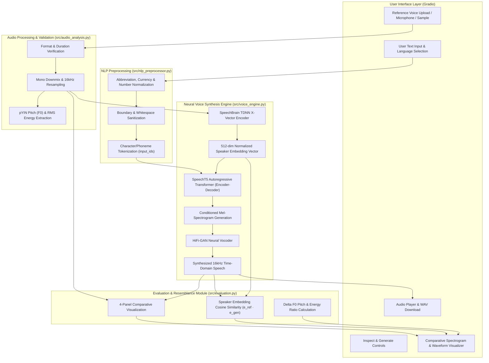

# VocalSense AI: Personalised Voice Cloning and Speech Synthesis

[](https://www.python.org/)
[](https://pytorch.org/)
[](https://huggingface.co/microsoft/speecht5_tts)
[](https://speechbrain.github.io/)
[](https://gradio.app/)
[](LICENSE)

An end-to-end deep learning application for **zero-shot, reference-conditioned voice cloning and speech synthesis**. VocalSense AI accepts an authorized user voice recording, analyzes its acoustic properties (pitch, energy, spectral distribution), extracts a deep latent speaker representation (512-dimensional x-vector), and synthesizes new, natural-sounding speech from arbitrary text in the target speaker's vocal timbre.

---

## 1. Project Overview & Problem Statement

### 1.1 Problem Statement
Conventional Text-to-Speech (TTS) systems rely on pre-recorded, static studio voices that lack personalization. Creating custom voices traditionally required recording hours of phonetically balanced speech in an acoustic chamber followed by lengthy transfer fine-tuning of neural acoustic models. 

### 1.2 Objective
**VocalSense AI** solves this challenge by implementing **zero-shot reference-conditioned voice cloning**. By leveraging deep speaker encoder representations (Time-Delay Neural Networks) coupled with autoregressive transformer acoustic synthesis and generative adversarial vocoding, the system clones a speaker's unique vocal characteristics from as little as **3 to 10 seconds** of speech without retraining or fine-tuning weights.

---

## 2. Key Features

1. **Reference Voice Ingestion & Audio Validation**:
   - Supports `.wav`, `.mp3`, `.ogg`, `.flac`, and `.m4a` audio formats.
   - Real-time format validation, stereo-to-mono downmixing, silence detection, amplitude normalization, and resampling to 16,000 Hz.
   - Provides bundled authorized reference samples (Speaker Alpha - Male range, Speaker Beta - Female range) alongside custom upload and microphone recording.

2. **Personalized Voice Cloning (Zero-Shot Synthesis)**:
   - Integrates Microsoft **SpeechT5** (`microsoft/speecht5_tts`) sequence-to-sequence transformer conditioned on speaker embeddings.
   - Uses **SpeechBrain** (`speechbrain/spkrec-xvect-voxceleb`) TDNN x-vector encoder trained on VoxCeleb to capture speaker timbre in 512 dimensions.
   - Employs **HiFi-GAN** (`microsoft/speecht5_hifigan`) neural vocoder for high-fidelity 16 kHz time-domain speech reconstruction.
   - Optimized for local CPU inference with caching to avoid redundant forward passes.

3. **Text Preprocessing & NLP Pipeline**:
   - Lexical normalization: abbreviation expansion (e.g., `Dr.` $\to$ `Doctor`, `AI` $\to$ `A I`), currency translation (`$10` $\to$ `10 dollars`), percentage expansion, and symbol sanitization.
   - Text length validation (safe boundaries for CPU memory) and language checking.
   - Clear architectural distinction between rule-based orthographic preparation and deep semantic NLP.

4. **Acoustic Signal Analysis**:
   - Fundamental frequency ($F_0$ / pitch) estimation using the probabilistic YIN (`pYIN`) algorithm with autocorrelation fallback.
   - Root Mean Square (RMS) energy calculation for volume and dynamic range analysis.
   - Spectral centroid measurement for acoustic brightness and timbral resonance.
   - Dual-domain visualization: Time-domain waveform and Mel-spectrogram frequency heatmaps.

5. **Comparative Speaker Evaluation**:
   - **Speaker Embedding Cosine Similarity**: Quantifies latent representation proximity in 512-dimensional vector space:
     $$\text{Cosine Similarity}(\mathbf{e}_{\text{ref}}, \mathbf{e}_{\text{gen}}) = \frac{\mathbf{e}_{\text{ref}} \cdot \mathbf{e}_{\text{gen}}}{\|\mathbf{e}_{\text{ref}}\| \|\mathbf{e}_{\text{gen}}\|}$$
   - Side-by-side comparative table of pitch, RMS energy, spectral centroid, and duration.
   - 4-panel comparative acoustic report (waveforms and mel-spectrograms side-by-side).

6. **Web User Interface**:
   - Interactive Gradio interface with custom CSS styling, progress tracking, in-browser audio playback, downloadable WAV export, and technical documentation tabs.

---

## 3. System Architecture

The modular architecture cleanly decouples inference, acoustic signal processing, evaluation, and user presentation:



---

## 4. Academic Integrity & Model Provenance

In accordance with academic research standards, this project explicitly distinguishes between original engineering and pretrained foundation models:

| Component | Source / Provenance | Role in VocalSense AI |
| :--- | :--- | :--- |
| **Speaker Encoder** | Pretrained: `speechbrain/spkrec-xvect-voxceleb` | Maps reference speech into a 512-dim x-vector speaker embedding. |
| **Acoustic Model** | Pretrained: `microsoft/speecht5_tts` | Autoregressive transformer generating mel-spectrograms conditioned on the speaker x-vector. |
| **Neural Vocoder** | Pretrained: `microsoft/speecht5_hifigan` | Generative adversarial vocoder synthesizing audio waveforms from mel-spectrograms. |
| **Audio Validation & Preprocessing** | **Original Implementation** (`src/audio_analysis.py`) | Multi-format validation, stereo downmixing, amplitude normalization, and 16 kHz resampling. |
| **Acoustic Analysis Module** | **Original Implementation** (`src/audio_analysis.py`) | pYIN F0 pitch tracking, autocorrelation fallback, RMS calculation, and Matplotlib plotting. |
| **NLP Preprocessing & Lexical Normalization** | **Original Implementation** (`src/nlp_preprocessor.py`) | Regex-based expansion of abbreviations, currencies, symbols, and length validation. |
| **Comparative Evaluation System** | **Original Implementation** (`src/evaluation.py`) | Mathematical cosine similarity calculation, acoustic discrepancies, and comparative reports. |
| **Web Interface & Session Management** | **Original Implementation** (`app.py`) | Gradio web application with state caching, responsive layout, and playback download. |

> **Scientific Clarification:** Pretrained neural weights perform the complex generative mapping from phonemes and speaker vectors to mel-spectrograms. We do not claim to have designed a new foundation neural architecture from scratch; our contribution is the end-to-end integration, preprocessing, acoustic feature analysis, evaluation suite, and local serving infrastructure.

---

## 5. Technology Stack

* **Deep Learning Framework:** PyTorch 2.9.1+cpu
* **Neural Speech Models:** HuggingFace `transformers` (SpeechT5, HiFi-GAN)
* **Speaker Verification & Embeddings:** SpeechBrain 1.1.1 (VoxCeleb TDNN x-vectors)
* **Audio Signal Processing:** `librosa` 1.0.0, `soundfile` 0.14.0, `scipy` 1.17.0
* **Numerical & Mathematical Operations:** `numpy` 2.3.4
* **Acoustic Visualization:** `matplotlib` 3.10.7
* **Web UI Framework:** `gradio` 6.30.0
* **Test Suite:** `pytest` 9.0.3

---

## 6. Installation & Setup

### 6.1 Prerequisites
* Python 3.12 or 3.14 (64-bit)
* Minimum 8 GB RAM (16 GB recommended for CPU inference)
* ~3 GB free disk space (for pretrained model weights and dependencies)

### 6.2 Step-by-Step Installation

1. **Clone or Navigate to the Workspace**:
   ```powershell
   cd "C:\Users\hp\OneDrive\Documents\3rd sem All LAB\VocalSenseAI"
   ```

2. **Install Dependencies**:
   ```powershell
   pip install -r requirements.txt
   ```

3. **Verify the Installation & Run Tests**:
   ```powershell
   python -m pytest tests/ -v
   ```
   *Expected output: All 21 unit tests passing.*

---

## 7. Launch Command & Usage

### 7.1 Launch Command
To start the VocalSense AI application, execute:

```powershell
python app.py
```

The web server will initialize and display:
```
[VocalSense AI] Starting Gradio Web Server on local interface...
Running on local URL:  http://127.0.0.1:7860
```

Open your browser and navigate to **`http://127.0.0.1:7860`**.

### 7.2 Demonstration Procedure (3-Minute Walkthrough)
1. **Select Reference Voice**:
   - Choose `Authorized Speaker Alpha (Male Tone)` or `Authorized Speaker Beta (Female Tone)` from the dropdown.
   - Alternatively, upload your own `.wav` recording or use the built-in microphone recorder.
2. **Inspect Acoustic Properties**:
   - Click `🔍 Inspect Reference Audio Properties`.
   - Observe the fundamental frequency ($F_0$), RMS energy, and generated waveform / mel-spectrogram.
3. **Input Sentence**:
   - Select a sample sentence from the dropdown (e.g., *"Welcome to VocalSense AI. Your personalized voice cloning system is active."*) or type custom text.
4. **Generate Cloned Speech**:
   - Click `🎙️ Generate Cloned Speech`.
   - Follow progress bar updates (text validation $\to$ x-vector extraction $\to$ transformer synthesis $\to$ acoustic evaluation).
5. **Listen & Download**:
   - Play the generated audio directly in the embedded player.
   - Download the clean 16 kHz WAV file via the file download widget.
6. **Review Evaluation & Resemblance**:
   - Examine the **Speaker Embedding Cosine Similarity** (typically $0.55 - 0.85$ for cross-sentence zero-shot cloning).
   - Review the 4-panel comparative acoustic plot comparing reference vs. generated waveforms and spectrograms.

---

## 8. Evaluation Methodology & Scientific Limitations

### 8.1 Speaker Embedding Cosine Similarity
Speaker identity is conditioned through deep latent representations. The cosine similarity between the reference x-vector $\mathbf{e}_{\text{ref}}$ and the generated audio's x-vector $\mathbf{e}_{\text{gen}}$ measures timbral preservation:
* **$\ge 0.70$:** High speaker timbre resemblance.
* **$0.50 - 0.70$:** Moderate resemblance (typical for zero-shot cross-utterance neural synthesis).
* **$< 0.50$:** Divergent speaker characteristics.

### 8.2 Acoustic Metrics vs. Speaker Identity
* **Fundamental Frequency ($F_0$ / Pitch):** $F_0$ is dynamic and sentence-dependent. A pitch difference of $\pm 20-50$ Hz between an interrogative and declarative sentence is normal prosody. Pitch similarity alone **cannot** prove identity.
* **RMS Energy:** Indicates loudness and recording distance, not voice authenticity.
* **Biometric Identity Disclaimer:** Acoustic measurements describe signal properties of a recording. They cannot serve as legal biometric proof of human identity.

---

## 9. Privacy, Ethics & Responsible AI

1. **Authorized Usage Only**: VocalSense AI is strictly designed for assistive speech technology, educational demonstrations, and authorized voice reproduction (using the user's own voice or recordings with explicit permission).
2. **Zero Deceptive Impersonation**: Generating speech for fraud, harassment, misinformation, or bypassing voice biometric authentication is strictly forbidden.
3. **100% Local Inference**: All audio preprocessing, embedding extraction, and synthesis execute locally on the user's CPU/GPU. No voice samples, embeddings, or transcripts are transmitted to external servers.
4. **Synthetic AI Labeling**: All generated audio files and UI interfaces are watermarked with an explicit notice: *AI-generated synthetic speech*.

---

## 10. Repository Structure

```
VocalSenseAI/
├── app.py                      # Main Gradio interactive web application
├── requirements.txt            # Pinned dependency requirements
├── README.md                   # Comprehensive project documentation
├── conftest.py                 # Pytest configuration & environment setup
├── .gitignore                  # Git tracking rules
├── src/                        # Core application modules
│   ├── __init__.py             # Package marker
│   ├── nlp_preprocessor.py     # Text validation & lexical normalization
│   ├── audio_analysis.py       # Audio validation, pYIN pitch tracking & plotting
│   ├── voice_engine.py         # SpeechT5 & SpeechBrain inference engine
│   └── evaluation.py           # Cosine similarity & comparative report generation
├── samples/                    # Bundled authorized reference audio clips
│   ├── sample_speaker_male.wav # Speaker Alpha sample voice (16 kHz WAV)
│   └── sample_speaker_female.wav # Speaker Beta sample voice (16 kHz WAV)
├── outputs/                    # Output directory for synthesized speech and plots
│   └── .gitkeep
└── tests/                      # Automated unit test suite (21 tests)
    ├── test_nlp.py             # NLP & text validation tests (7 tests)
    ├── test_audio_analysis.py  # Audio validation & acoustic property tests (7 tests)
    ├── test_voice_engine.py    # Neural synthesis & embedding tests (3 tests)
    └── test_evaluation.py      # Speaker similarity & comparative report tests (4 tests)
```

---

## 11. Known Limitations & Future Work

* **Language Scope:** The current SpeechT5 model checkpoint is trained primarily on English phonetics (LibriTTS). Cross-lingual synthesis requires fine-tuning on multilingual datasets (e.g., Common Voice).
* **CPU Inference Latency:** Running autoregressive transformer generation and HiFi-GAN vocoding on CPU has a Real-Time Factor (RTF) of $\approx 1.2 - 2.5\times$ (generating 5 seconds of speech takes $\approx 6 - 12$ seconds). On a CUDA GPU, this reduces to $<0.3\times$.
* **Reference Audio Sensitivity:** Background noise, heavy room reverberation, or overlapping speakers in the reference sample will degrade the extracted speaker embedding. Clean audio yields the best synthesis quality.
